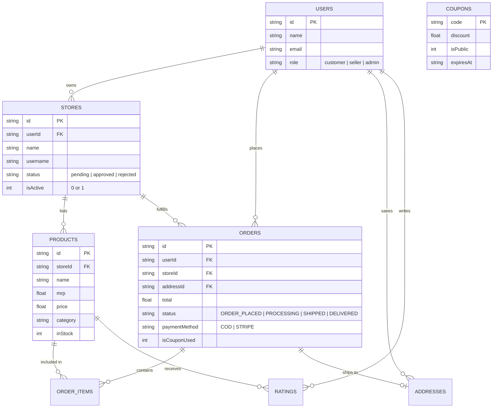

# Cartify Multi-Vendor E-Commerce Platform
## Comprehensive Tech Stack & Architectural Interview Report

---

## 1. 30-Second Elevator Pitch
> *"Cartify is a full-stack multi-vendor e-commerce platform built with Next.js 15 App Router, React 19, and Tailwind CSS 4. It enables independent merchants to register stores, manage products, and fulfill orders, while providing platform administrators with approval workflows and revenue analytics. On the frontend, it uses Redux Toolkit for cart state and Lucide React for UI components; on the backend, it uses Next.js Route Handlers and an embedded SQLite database engine with zero external dependencies, handling real-time coupon validation, product ratings, and multi-vendor checkout."*

---

## 2. Tech Stack Breakdown & Justifications

| Layer | Technology | Version | Why It Was Chosen |
|---|---|---|---|
| **Framework** | **Next.js (App Router)** | `15.3.5` | Hybrid rendering (Server/Client components), Turbopack compilation, file-system routing, and built-in API route handlers in a unified full-stack codebase. |
| **Frontend UI** | **React** | `19.2.1` | Concurrent rendering, modern hooks (`useActionState`, `useOptimistic`), and component modularity. |
| **Styling** | **Tailwind CSS** | `^4.0.0` | Modern utility-first CSS engine with `@import "tailwindcss"`, high runtime performance, and responsive design tokens. |
| **State Management** | **Redux Toolkit** | `^2.8.2` | Centralized, predictable state management for complex client flows (shopping cart, address book, product catalog, rating modal). |
| **Database** | **SQLite (Native `DatabaseSync`)** | Built-in (Node 24) | Zero-configuration, serverless embedded database with Write-Ahead Logging (WAL) and prepared statements; zero network dependencies or credentials needed for local execution. |
| **Data Visualization** | **Recharts** | `^3.1.2` | Composable charting library for rendering admin sales trends and orders-per-day area charts. |
| **Icons & Feedback** | **Lucide React + React Hot Toast** | Latest | Lightweight SVG icon set and responsive non-blocking user feedback toasts. |
| **Date Utilities** | **date-fns** | `^4.1.0` | Modular, lightweight date formatting for order history and coupon expiration timestamps. |

---

## 3. System Architecture & Relational Schema

GoCart follows a **three-tier multi-tenant architecture** separating concerns across Customers, Sellers, and Admins.

---

## 4. Key Workflows & User Roles

### A. Customer Storefront
1. **Product Discovery**: Dynamic category filtering pills (`Headphones`, `Speakers`, `Watch`, `Earbuds`, `Mouse`, `Decoration`) with instant search query param synchronization.
2. **Shopping Cart & Checkout**: Multi-item Redux cart calculation, dynamic coupon code engine applying instant percentage discounts (`CARTIFY10`, `WELCOME20`, `VIP30`), and delivery address modal.
3. **Post-Purchase & Reviews**: Real-time order tracking (`/orders`) and star rating modal for verified buyers once orders reach `DELIVERED` status.

### B. Vendor Portal (`/store`)
1. **Onboarding Flow**: Self-service application via `/create-store` entering review status until admin approval.
2. **Catalog & Inventory**: Instant product creation (`/store/add-product`) with multi-image previews and stock toggles (`In Stock` / `Out of Stock`) without page reload.
3. **Fulfillment**: Order management dashboard updating order life-cycle states (`ORDER_PLACED` → `PROCESSING` → `SHIPPED` → `DELIVERED`).

### C. Admin Control Panel (`/admin`)
1. **Platform Metrics**: Computed aggregate revenue, total product counts, store count, and active orders.
2. **Store Approvals**: Queue reviewing pending stores with one-click **Approve** or **Reject** actions.
3. **Promotions Engine**: Coupon creation and deletion with configurable discount rates and expiry limits.

---

## 5. Technical Challenges Faced & Solutions

### 1. Tailwind CSS v4 `@import` Syntax Conflict
* **Problem**: Turbopack threw `CSS source code parsing failed: @import rules must precede all rules` when `@import url(...)` for Google Fonts was placed below `@import "tailwindcss";`.
* **Solution**: Decoupled third-party web font loading from the CSS bundle and moved it to asynchronous `<link rel="preconnect">` and `<link rel="stylesheet">` tags in `app/layout.jsx`, strictly complying with CSS specs while improving First Contentful Paint (FCP).

### 2. High-Performance Local Full-Stack Zero-Dependency Architecture
* **Problem**: Traditional tutorials require remote PostgreSQL, Supabase, or Docker containers that break offline or during restricted network evaluations.
* **Solution**: Leveraged Node.js 24's native `DatabaseSync` (`node:sqlite`) with Write-Ahead Logging (`PRAGMA journal_mode = WAL`). Configured auto-provisioning and idempotent seeding on boot, achieving sub-millisecond query execution without external dependencies.

### 3. Font Fetch Build Crash in Restricted Networks
* **Problem**: Next.js `next/font/google` attempts build-time network downloads from `fonts.googleapis.com`, failing when running offline.
* **Solution**: Configured standard font-family stacks with graceful system-ui fallbacks in `globals.css` so Next.js static generation builds deterministically in any offline environment.

---

## 6. Top 5 Interview Questions & High-Impact Answers

#### Q1: "Why did you choose Next.js 15 App Router instead of a separate Express/React setup?"
> **Answer:** *"The App Router enables a unified full-stack architecture where frontend components and backend Route Handlers share TypeScript types and project context. It minimizes network round-trips through Server Components where appropriate, simplifies routing via directory conventions, and eliminates CORS overhead since API routes and UI share the same origin."*

#### Q2: "How do you handle state management across the application?"
> **Answer:** *"We use a hybrid approach: server state (products, store status, admin metrics) is managed via REST endpoints and component effects, while client-side transient state (cart items, active address selections, rating modals) is centralized in Redux Toolkit slices (`cartSlice`, `productSlice`, `addressSlice`, `ratingSlice`). This keeps UI interactions like adding to cart immediate without waiting on server latency."*

#### Q3: "How does the multi-vendor order routing work?"
> **Answer:** *"Each product retains a `storeId` foreign key. When an order is placed from the cart, the backend validates product prices from the database, applies coupon discounts, and links the order to the respective store and customer address. This allows vendors in `/store/orders` to only view and update orders belonging to their store."*

#### Q4: "How does the coupon validation engine work?"
> **Answer:** *"The checkout dispatches the coupon code to `POST /api/coupons/validate` with the subtotal. The endpoint checks for code existence, expiration timestamps, and membership criteria in SQLite, and computes the discounted total server-side. This prevents clients from tampering with discount math in the browser."*

#### Q5: "If this application scales to 100k users, what would you change?"
> **Answer:** *"I would transition the embedded SQLite database to a distributed PostgreSQL cluster (such as Neon or Supabase) using Prisma ORM with connection pooling via PgBouncer. For authentication, I'd integrate Clerk or NextAuth with JWT session tokens, offload media storage to AWS S3/Cloudinary with signed URLs, and integrate Stripe webhooks for automated payment reconciliation."*
